Voici toutes les interpolation présentes dans le logiciel, triées par type de cellule. Avec un petit screenshot des 'bent block', avec le 'sample period' du renderer élevé.

Liste avec screenshots :

# [hex08] Hexahedron order 1

## Linear Interpolation

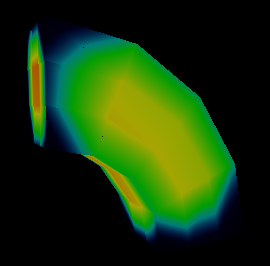


# [hex20] Hexahedron order 2

## First order : Linear Interpolation

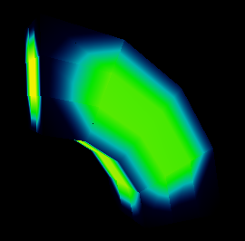

## High order : Lagrange Interpolation

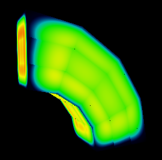

## High order : Serendipity Interpolation (C0-continuous across element boundaries)


## High order : Least Squares Quadratic Interpolation

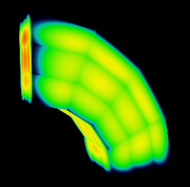


# [hex27] Hexahedron order 2 "full"

## First order : Linear Interpolation

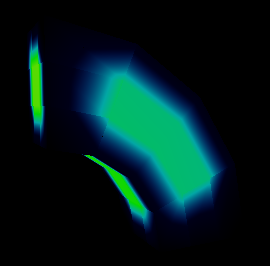

## High order : Full-Tensorial Lagrange Interpolation

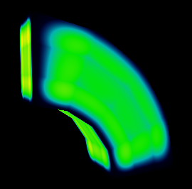


# [hex64] Hexahedron order 3

PS : Vue par en dessous c'est bon, vu par au dessus il apparaît des faces internes sur le modèle, je ne comprends pas trop pouquoi. J'ai ajouté un screenshot dans l'autre sens.

## First order : Linear Interpolation

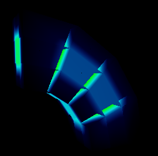 .png)

## High order : Full-Tensorial Lagrange Interpolation

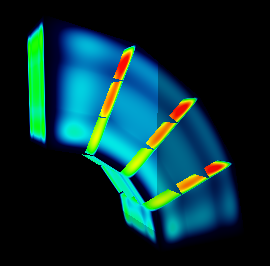 .png)


# [pri06] Prism order 1

> Prisme à base triangle. Aussi appelé "Wedge".

## First order : Linear Interpolation

Pas de screenshot.


# [pyr05] Pyramid order 1

> Pyramide à base carrée.

## First order : Linear Interpolation

Pas de screenshot.


# [tet04] Tetrahedron order 1

## Linear Interpolation

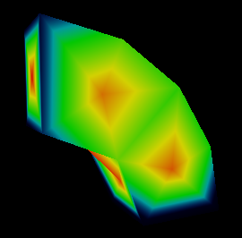


# [tet10] Tetrahedron order 2

## First order : Linear Interpolation

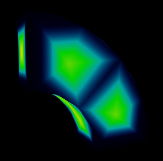

## High order : Lagrange Interpolation

> J'ajoute des screenshots à sample élevé, lagrange et serendipity ne donnent pas le résultat souhaité, mais a priori c'est normal et abandonné. Je les ai laissé simplement pour comparaison ou test.

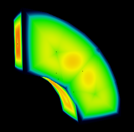 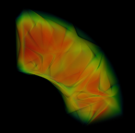

## High order : Serendipity Interpolation (C0-continuous across element boundaries)

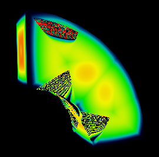 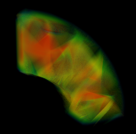

## High order : Full-Tensorial Lagrange Interpolation

> Ici aucun souci

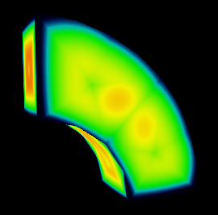 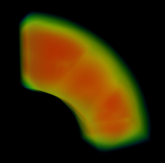


# [tet20] Tetrahedron order 3

## First order : Linear Interpolation


## High order : Full-Tensorial Lagrange Interpolation


# Hex343 ?

J'ai trouvé une interpolation, cependant je ne sais pas quel fichier aurait une telle cellule pour tester.

Dans le code elle s'appelle `evaluateGmshHex343Field()` , je la mets en entier :
(Je ne sais pas quel type d'interpolation c'est, je vois trois `lagrangeBasis1D()` cependant)

```cpp
// ---------------------------------------------------------------------------
// Complete Q6 scalar field in native Gmsh local-node ordering.
//
// coefficients[m] and HEX343_NODE_IJK[m] use the same Gmsh local DOF.
// No CPU permutation is performed.
// ---------------------------------------------------------------------------
static __forceinline__ __device__
float evaluateGmshHex343Field(
	const float* coefficients,
	const float3 ref)
{
	float basisG[7];
	float basisH[7];
	float basisR[7];

	#pragma unroll
	for(int index = 0;
		index < 7;
		++index)
	{
		basisG[index] =
			lagrangeBasis1D(
				ref.x,
				index,
				NODES_1D_ORDER6,
				7);

		basisH[index] =
			lagrangeBasis1D(
				ref.y,
				index,
				NODES_1D_ORDER6,
				7);

		basisR[index] =
			lagrangeBasis1D(
				ref.z,
				index,
				NODES_1D_ORDER6,
				7);
	}

	float result = 0.f;

	for(int localDof = 0;
		localDof < 343;
		++localDof)
	{
		// const int i =
		//     HEX343_NODE_IJK[localDof][0];

		// const int j =
		//     HEX343_NODE_IJK[localDof][1];

		// const int k =
		//     HEX343_NODE_IJK[localDof][2];

		const int i = HEX343_LIBMESH_NODE_IJK[localDof][0];
		const int j = HEX343_LIBMESH_NODE_IJK[localDof][1];
		const int k = HEX343_LIBMESH_NODE_IJK[localDof][2];

		const float shapeValue =
			basisG[i]
		  * basisH[j]
		  * basisR[k];

		result += coefficients[localDof] * shapeValue;
	}

	return result;
}
```

et plus loin j'ai la fonction `evaluateHexahedralElementField()` qui contient un switch, et le hex 343 y est

```c
case 6:
{
	if(field.dofsPerCell != 343)
	{
		return 0.f;
	}

	return evaluateGmshHex343Field(
		coefficients,
		ref);
}
```

Si j'ai bien compris il n'y a pas d'interpolation hex343 high order "classique", mais seulement "element field" :

# "Element"

J'ai inclus le code pour les cellules format "element", je n'ai pas encore réussi à tout faire fonctionner, je dois tester avec le `Data_from_vizir4/Main_data_with_order6/PML_hexa_element2727.msh` j'imagine. Il y a-t-il d'autres dossiers/fichiers à tester pour ce mode ?


# Question à propos de lagrange

J'ai trouvé des interpolation qui retournent une valeur avec une interpolation de lagrange, donc je les considère "High order, lagrange interpolation". Mais, j'ai aussi trouvé des interpolations qui sont plus courtes et qui était nommées full tensorial, je les considère "High order, lagrange full-tensorial interpolation". Mais quelle est la différence entre les deux ? 

# Pyramide et Prisme

Je n'ai a priori pas de fichier possédant ces cellules. Serait-il possible de tester ces deux formats de cellules ?

Aussi, j'ai vu dans le code des `#define` pour pyramide ordre 2 et prisme ordre 2, mais pas d'interpolation existante. 

# Liste texte : 

```
[hex08] Hexahedron order 1
	First order :
		Linear Interpolation

[hex20] Hexahedron order 2
	First order :
		Linear Interpolation
	High order :
		Lagrange Interpolation
		Serendipity Interpolation (C0-continuous across element boundaries)
		Least Squares Quadratic Interpolation

[hex27] Hexahedron order 2 "full"
	First order :
		Linear Interpolation
	High order :
		Full-Tensorial Lagrange Interpolation

[hex64] Hexahedron order 3
	First order :
		Linear Interpolation
	High order :
		Full-Tensorial Lagrange Interpolation

[pri06] Prism order 1
	First order :
		Linear Interpolation

[pyr05] Pyramid order 1
	First order :
		Linear Interpolation

[tet04] Tetrahedron order 1
	First order :
		Linear Interpolation

[tet10] Tetrahedron order 2
	First order :
		Linear Interpolation
	High order :
		Lagrange Interpolation
		Serendipity Interpolation (C0-continuous across element boundaries)
		Full-Tensorial Lagrange Interpolation

[tet20] Tetrahedron order 3
	First order :
		Linear Interpolation
	High order :
		Full-Tensorial Lagrange Interpolation
```